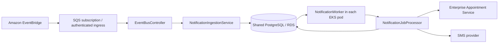
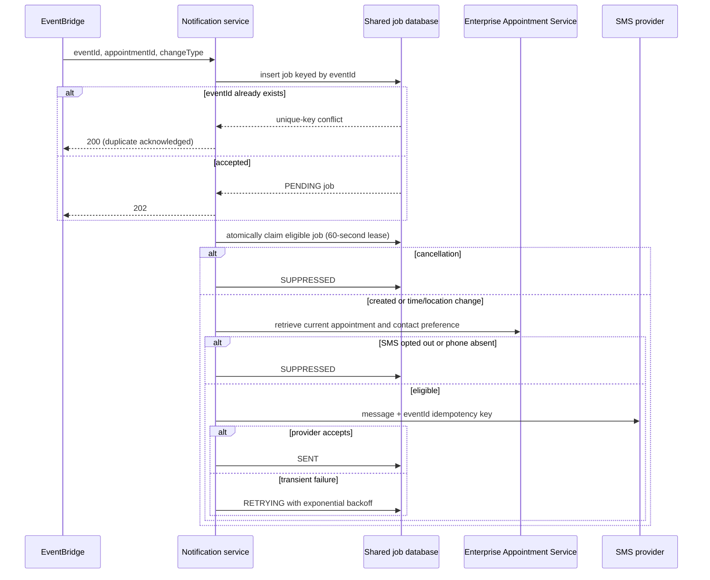

# Appointment Notification Service

This Spring Boot service turns appointment-change events into reliable SMS notifications. It is intended for a healthcare environment where EventBridge may redeliver events, the Enterprise Appointment Service or SMS provider can be unavailable, and multiple service replicas run in Amazon EKS.

The service notifies patients for a newly created appointment or an appointment time/location change. Cancellations are recorded but deliberately suppressed under the stated business rule. Before sending, it retrieves the current appointment from the Enterprise Appointment Service and respects the patient's SMS contact preference.

## Architecture



The repository currently provides a demo HTTP adapter at `POST /internal/eventbus/appointment-changes`, an in-memory H2 database, a demo appointment client, and a logging SMS gateway. They make the workflow runnable locally. A production deployment must replace H2 with a shared, durable database; use an EventBridge-to-SQS consumer or authenticated private ingress; and provide real `EnterpriseAppointmentClient` and `SmsGateway` implementations.

## User flow



## Code walkthrough

| Component | Responsibility |
|---|---|
| `AppointmentChangeEvent` | Immutable inbound event model. Defines `APPOINTMENT_CREATED`, `TIME_OR_LOCATION_CHANGED`, and `APPOINTMENT_CANCELLED`; only the first two require notification. |
| `EventBusController` | Demo boundary adapter. Validates required identifiers and change type, then returns `202 Accepted` for a new event or `200 OK` for a duplicate. Its payload has no patient name, phone number, or clinical details. |
| `NotificationIngestionService` | Stores a `NotificationJob` in one transaction. `eventId` is the job primary key, giving database-enforced idempotency across pods and EventBridge redeliveries. |
| `NotificationJob` | Durable state machine: `PENDING`, `PROCESSING`, `SENT`, `SUPPRESSED`, `RETRYING`, or `FAILED`. It stores only event and appointment identifiers, status, attempt count, lease, and timestamps. |
| `NotificationJobRepository` | Finds due or expired-lease work and atomically claims an individual row using a conditional update. A claim succeeds for exactly one pod. |
| `NotificationWorker` | Runs every second and asks for up to 25 eligible job IDs. It delegates each one to a separate transactional processor. |
| `NotificationJobProcessor` | Claims a job for 60 seconds, suppresses cancellations and opted-out patients, loads fresh appointment data, renders an SMS, sends it, and records the final outcome. Failures retry after 30, 60, 120, 240, then 480 seconds; the fifth failed attempt becomes `FAILED`. |
| `EnterpriseAppointmentClient` / `DemoEnterpriseAppointmentClient` | Port and local implementation for current appointment, clinic, phone, and consent data. Production should call the enterprise service over authenticated TLS. |
| `SmsGateway` / `LoggingSmsGateway` | Port and local implementation for provider delivery. The production implementation must pass `eventId` as the provider's idempotency key. The demo never logs a phone number or message body. |

The worker intentionally fetches the current appointment after it claims a job rather than trusting the event payload. That ensures delivery uses current consent and appointment details even when an older event is processed late.

## Architectural decisions

| Decision | Why |
|---|---|
| Durable database job record instead of in-memory queue state | Events and outcomes survive pod restarts, deployments, and downstream outages. |
| `eventId` as database primary key | The database is the concurrency authority; this eliminates races between EKS pods and handles at-least-once delivery. |
| Conditional `UPDATE` claim plus lease | Only one pod can process a job at a time. A pod crash leaves a lease that another pod can reclaim after 60 seconds. |
| Provider idempotency key equals `eventId` | A network timeout can leave the service uncertain whether an SMS was accepted. Provider-side idempotency makes retries safe and provides effectively-once patient delivery when the provider honors the key. |
| Separate transactional processor bean | Scheduling invokes the worker through Spring but not its own internal methods. Delegation ensures each job is executed through Spring's transaction proxy. |
| Minimal persisted data and redacted logs | Phone numbers, message content, patient data, and downstream error messages are not persisted or logged. Runtime data is used only to make the appointment lookup and provider call. |
| H2 only for local execution | A memory database is convenient for the sample but cannot coordinate pods or survive restarts; PostgreSQL/Aurora RDS is mandatory in EKS. |

## Tradeoffs and limitations

- **Database polling vs. SQS work consumption:** polling makes the durable job state and recovery logic explicit, but adds up to the configured polling delay and database reads. At high volume, consume SQS batches directly into the job table or use a queue-driven worker while retaining the same idempotent job table.
- **Claim lease vs. long provider calls:** a 60-second lease avoids permanent lockout after a crash. It must be longer than normal Enterprise Appointment Service and SMS-provider latency; otherwise, renew the lease or use a longer configurable lease.
- **Provider idempotency is required for exactly-once SMS:** the local gateway only demonstrates the contract. Without a provider idempotency key, an outage boundary can only provide at-least-once delivery.
- **Business rule scope:** cancellation is suppressed because that is the supplied assumption. A cancellation-notification policy is a small change to `requiresNotification` and the processor branch.
- **Terminal failures need operations:** after five attempts the code records `FAILED`; production should expose metrics, alerts, and an authenticated reconciliation/replay operation.
- **The HTTP controller is an adapter, not a public EventBridge endpoint:** production must use private networking plus IAM/workload identity and validate the delivery path. Do not expose `/internal/eventbus/**` on a public load balancer.

## Local run

Prerequisites: Java 17.

```bash
./mvnw spring-boot:run
```

Send a local event:

```bash
curl -i -X POST http://localhost:8080/internal/eventbus/appointment-changes \
  -H 'Content-Type: application/json' \
  -d '{
    "eventId": "11111111-1111-1111-1111-111111111111",
    "appointmentId": "22222222-2222-2222-2222-222222222222",
    "changeType": "APPOINTMENT_CREATED",
    "occurredAt": "2026-10-01T12:00:00Z"
  }'
```

The first submission returns `202`; submitting the identical `eventId` again returns `200` and does not create another job. The demo client marks the patient opted in and the demo gateway records only an event ID in the log.

## Test and validation

Run all tests:

```bash
./mvnw clean test
```

`NotificationWorkflowTests` validates:

1. A new appointment for an opted-in patient is sent with the inbound `eventId` as the provider idempotency key and finishes as `SENT`.
2. A time/location change is suppressed when SMS consent is absent.
3. A cancellation does not fetch appointment data and is `SUPPRESSED`.
4. An SMS provider failure changes the job to `RETRYING` with a future retry time rather than losing the event.
5. A database unique-key violation is treated as a harmless duplicate delivery.

`AppointmentAppApplicationTests` starts the full Spring context, including JPA repository query validation and the H2 schema.

## Scaling on EKS

1. Deploy the service as multiple stateless replicas behind a private ingress or, preferably, with an EventBridge-to-SQS subscription. Configure the pod service account through IRSA with only the permissions needed to read its SQS queue and retrieve required secrets.
2. Point every replica at the same Multi-AZ PostgreSQL/Aurora RDS cluster. Do **not** use the local H2 configuration in EKS. The shared `notification_job` table and `eventId` primary key are what provide cross-pod deduplication.
3. Every pod may run `NotificationWorker`. Each pod reads candidate IDs, but `NotificationJobRepository.claim` is a conditional update: only one pod receives an update count of one and sends the SMS. An expired lease safely reassigns work after a pod loss.
4. Horizontally scale based on SQS queue depth/age (if using SQS), pending and retrying job count, job age, provider latency, CPU, and database connection utilization. Bound worker batch size and JDBC pool size per replica so HPA scale-out does not exhaust RDS connections.
5. Use an external secrets manager for database and provider credentials, TLS for all traffic, KMS encryption for RDS storage and backups, restrictive network policies/security groups, and redacted structured logs. Export counts by job status, claim conflicts, retries, terminal failures, and processing latency to CloudWatch/Prometheus.
6. Add readiness checks that verify application startup and database connectivity, and graceful termination that stops new polls before the pod's termination grace period. In-flight jobs recover through their lease if a pod is terminated.

